[中文](README.md) | [English](README.en.md)

# LessonDesk · Driving School Scheduling and Lesson Management

ZhiHua Technology (Shanghai Rujing Zhihua Information Technology Co., Ltd.) · [Website](https://www.zhuatech.cn/)

LessonDesk connects student profiles, package enrollment, mobile bookings, instructor and vehicle schedules, check-in, training progress, minute credits and verified fee records. Office staff, finance, instructors and students share one persistent database; public visitors can browse packages and submit private inquiries. Java 21 / Spring Boot 4 / Vue 3 / MySQL 8.4, Chinese and English interfaces.

**Source-available, non-commercial learning edition.** Personal learning and non-commercial exchange only. Commercial use requires prior written authorization from Shanghai Rujing Zhihua Information Technology Co., Ltd. This is not an OSI-approved permissive license; see [LICENSE](LICENSE).

## Intended users and workflow

For independent driving schools with multiple instructors, shared vehicles and prepaid lesson packages, and implementation teams assessing branded school software. A solo instructor using a diary may not need this system. The first edition is a single-company, school-scoped H5 and administration application, not a government licensing platform or native app.

1. Create school organizations and individual accounts; link student and instructor profiles and maintain vehicles and training categories.
2. Publish explicit instructor work windows, leave, vehicle maintenance and a fixed after-lesson buffer; instructors maintain their own availability.
3. Enroll a student with frozen minutes, price, currency, validity and cancellation rules. Record actual verified payments; full payment is required before booking, except free packages.
4. Students book on mobile or office staff book for them. Available-slot searches do not reserve resources; submission rechecks instructor, vehicle, student and minute balance.
5. Check in, start teaching and record actual minutes, training topic and progress. Completion releases reservations and uses the recorded minutes.
6. Rescheduling does not reserve twice. Cancellation and no-show follow the purchased rules. Handle active lessons before closing enrollment, then record refunds against original payments.

Training categories (initially manual/automatic) are internal classifications, not verified government qualifications. An instructor can teach 1–8 categories; each vehicle and package has one. One lesson serves one student. Taught minutes are instructor attestations, not GPS measurement or official hour certification.

## Implemented interfaces

| Interface | Available operations |
|---|---|
| Office / management | School, student, instructor, vehicle and package directories; inquiries; enrollment; bookings, rescheduling, cancellation, check-in and no-show; work/leave/maintenance; search, pagination, sorting, reports and CSV |
| Finance | Purchase snapshots, verified manual receipts, enrollment closure, original-payment refunds, unique receipt references and currency-separated reports; no card or payment-gateway transactions |
| Instructor mobile | Assigned lessons, own work/leave, check-in, teaching, minute and progress records; no school-wide student contact list or finance |
| Student mobile | Own enrollment, reserved/used/available minutes, dates, payments, genuine availability, booking, rescheduling, cancellation, check-in and progress |
| Public | Enabled schools and packages, private inquiries with random receipt; no student or instructor accounts, contacts, or other bookings |
| System administration | Accounts, roles, permissions, menus, organizations/timezones, training dictionary, parameters, audit and own password changes |

Transactions use a database write lock, explicit versions and actor/payload-bound UUID commands. Identical retries do not duplicate minutes or money. Every request rechecks account, password fingerprint, role and organization. The last active full administrator is protected.

## Minute and refund rules

Lessons are 30–180 minutes in 15-minute steps; packages contain 30–60,000 minutes and 1–1,095 valid days. Money uses minor units and ISO currencies with two decimal places, reported separately.

Reserved and used minutes are distinct. An instructor records 0 to the reserved duration with topic, progress and reason; zero is available for interrupted, untaught lessons with an explanation. Terminal records cannot be rewritten or deleted. Late student cancellation and no-show use the frozen late-charge policy; office cancellation may waive the charge with a reason. Self-rescheduling must meet the frozen notice period.

Non-refundable value = package minor-unit price × used minutes ÷ purchased minutes, rounded up. After closure, each refund is limited by both remaining eligible balance and its original payment's unrefunded amount.

Times are stored in UTC. Availability query dates use the school timezone; window inputs and results use the browser timezone. An early finish retains the planned resource window/buffer. Overrunning unfinished lessons block subsequent starts; a late finish extends the end and buffer. See [operations](docs/OPERATIONS.md) and [API](docs/API.md).

## Requirements and startup

Docker Engine 27+ / Docker Desktop, Compose v2 with `--wait`, Python 3.10+, approximately 4 GB available memory and 4 GB disk. Local source development needs JDK21, Maven3.9+, Node.js **24.19.0+**, npm and MySQL8.4.

```bash
git clone https://github.com/zhuatech-han/zhuatech-lessondesk.git
cd zhuatech-lessondesk
python3 scripts/init-env.py
docker compose -p lessondesk config --quiet
docker compose -p lessondesk up -d --build --wait --wait-timeout 180
```

UI: <http://127.0.0.1:8146/>; health: <http://127.0.0.1:8146/actuator/health>; public packages: <http://127.0.0.1:8146/#public>. Initial username is `admin`; read the locally generated `ADMIN_PASSWORD` in private `.env`. There is **no shared demo password**. Passwords require 12–72 bytes with uppercase, lowercase and digits; never publish `.env` or save temporary QA passwords.

Empty databases initialize one school, administrator, five role types, menus, categories and parameters, **no students, lessons or receipts**. Schools create accounts and link profiles. Restart does not reset passwords, but backend in-memory sessions require a new sign-in after restart.

## Architecture and database

Browser → same-origin Nginx → Spring Security / Spring Boot transactions → MySQL. Core Vue data comes from APIs. Flyway initializes/upgrades the schema; JPA validates only. Identity, resource, enrollment, lesson, minute/cash, inquiry, history and audit records persist in MySQL. Serialized writes target modest single-instance usage, not distributed high concurrency.

The database is MySQL 8.4; JDBC uses unmodified MariaDB Connector/J 3.5.10 (LGPL). Third-party licenses remain separate; see [third-party notices](docs/THIRD_PARTY.md).

```text
backend/src/main/java/cn/zhuatech/lessondesk/  Identity, scheduling and ledgers
backend/src/main/resources/db/migration/    V1 identity, V2 business, V3 categories/receipts
backend/src/test/                           Policy and real API integration tests
frontend/src/                              Office, instructor, student and public interfaces
frontend/public/brand/                     Original brand assets
scripts/                                   Initialization, verification, backup/restore
compose.yaml / compose.dev.yaml            Bundled infrastructure / localhost debugging
.github/workflows/verify.yml                Fresh MySQL and full workflow verification
docs/                                      Manuals and real screenshots
```

Do not edit released migrations. Add versions for future changes and back up before upgrades; do not replace migrations with `ddl-auto=update`. V3 preserves existing single instructor categories and expands the set. See [deployment](docs/DEPLOYMENT.md).

## Configuration and source development

`.env.example` contains names/instructions only; initialization generates independent random secrets and refuses overwriting `.env`.

| Variable | Purpose |
|---|---|
| `MYSQL_ROOT_PASSWORD`, `DATABASE_PASSWORD` | Bundled database strong secrets |
| `ADMIN_USERNAME`, `ADMIN_PASSWORD` | First empty-database administrator |
| `WEB_PORT`, `BIND_ADDRESS` | Defaults 8146 and 127.0.0.1; change the port without stopping other projects |
| `COOKIE_SECURE` | false for localhost HTTP; true behind operational HTTPS |
| `DATABASE_URL`, `DATABASE_USER` | Optional external MySQL, with trusted CA/hostname checks; bundled backup does not manage it |
| `MYSQL_DEV_PORT` | Debug override's localhost port 33146 |

```bash
docker compose -p lessondesk-dev -f compose.yaml -f compose.dev.yaml up -d mysql
python3 scripts/dev-backend.py
# In another terminal:
cd frontend
npm ci --no-audit --no-fund
npm run dev
```

Vite5173 proxies local8080; production Nginx uses container service names. Override: `WEB_PORT=8150 docker compose -p lessondesk up -d`.

## Actual running screens

Screens show synthetic TEST records entered into an isolated QA database, not customer cases. A new installation has no such business data. No credentials or OS/save-password dialogs appear in the images.

### Sign-in: individual accounts
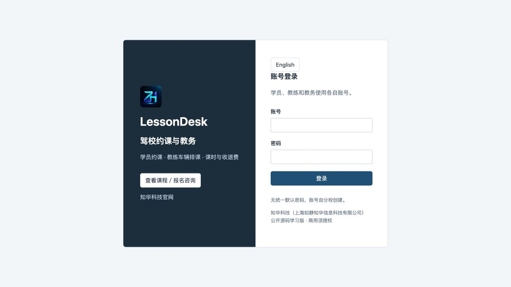

### Office: searchable lesson schedule
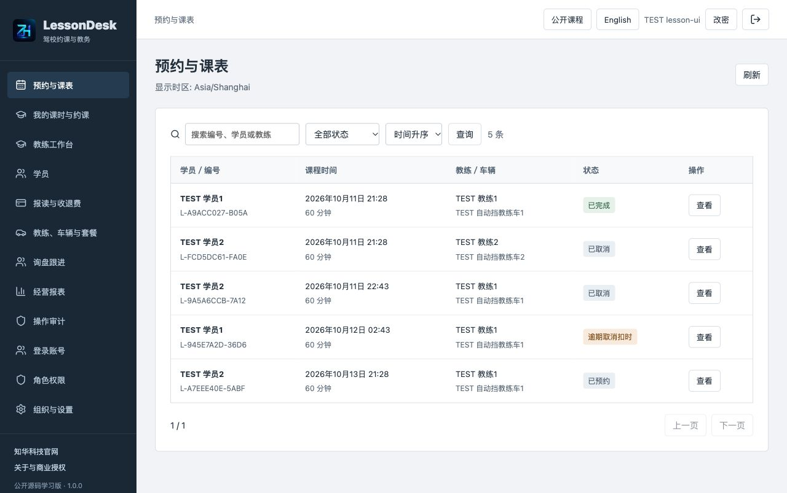

### Student: own packages and credits
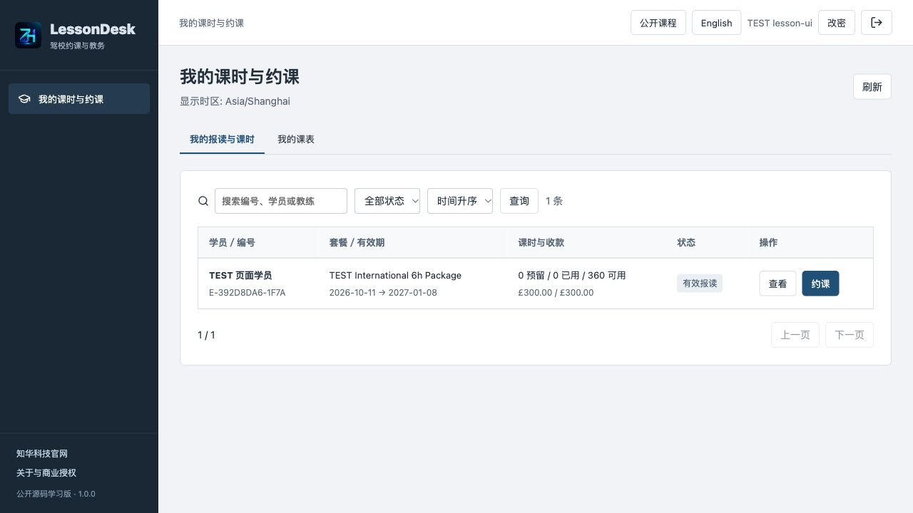

### Booking: real instructor and vehicle availability
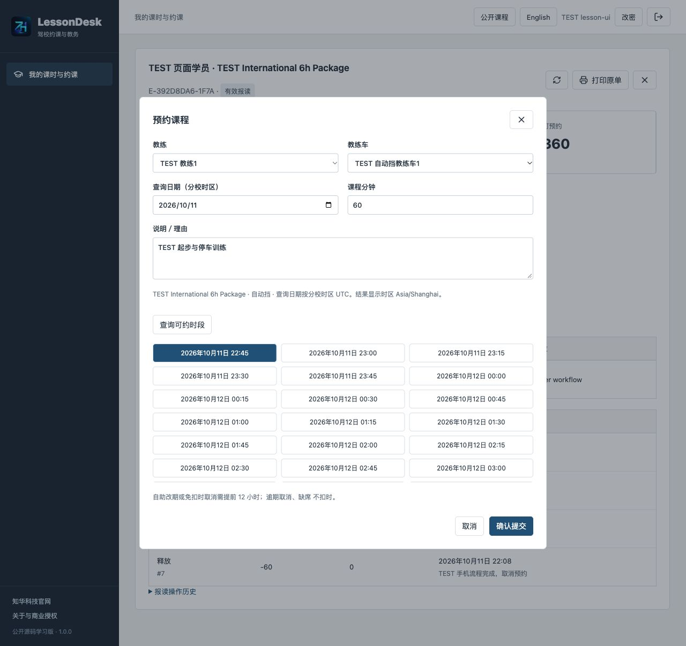

### Instructor: assigned lessons and progress
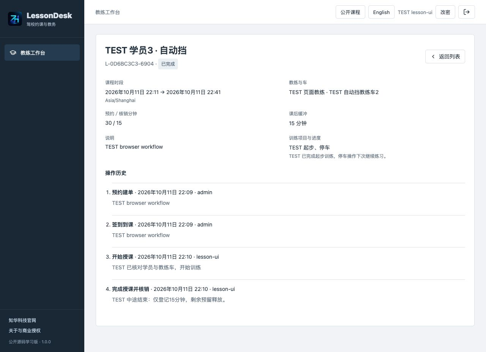

### Enrollment: payment and minute ledgers
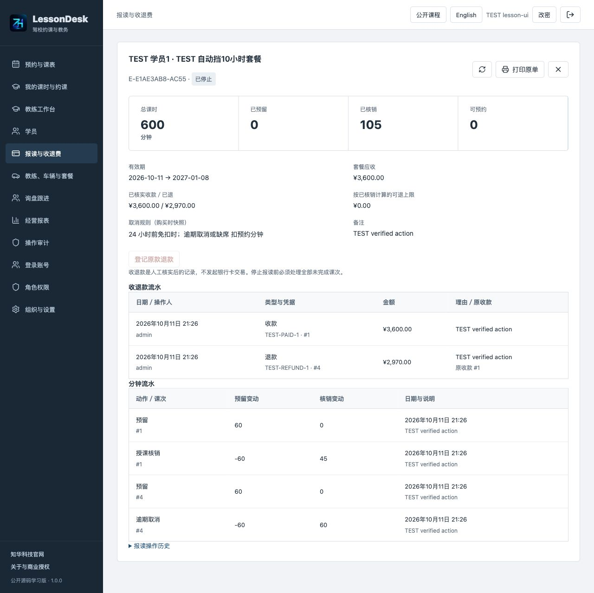

### Instructor and vehicle directory
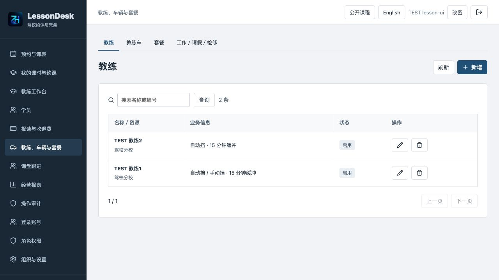

### Administration: account status and roles
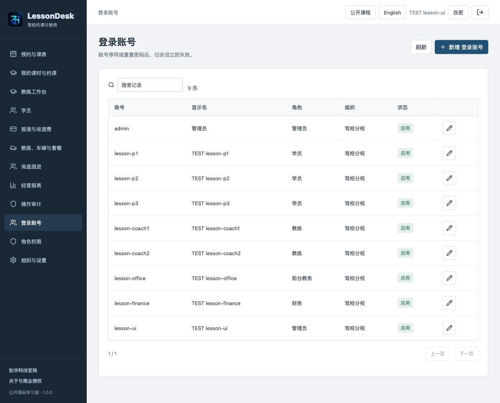

### Reports: currency-separated cash records
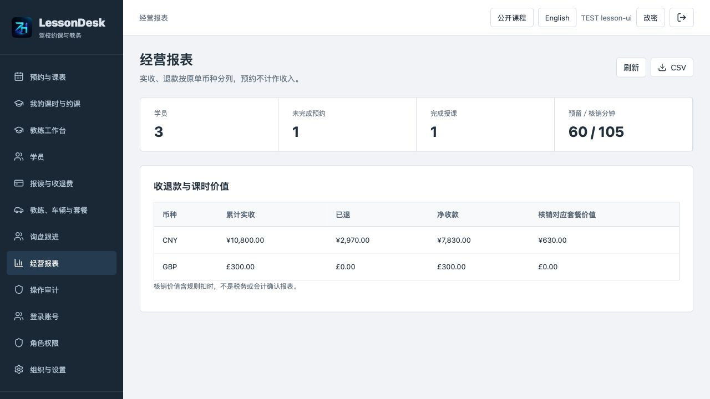

### Permissions: school and role scopes
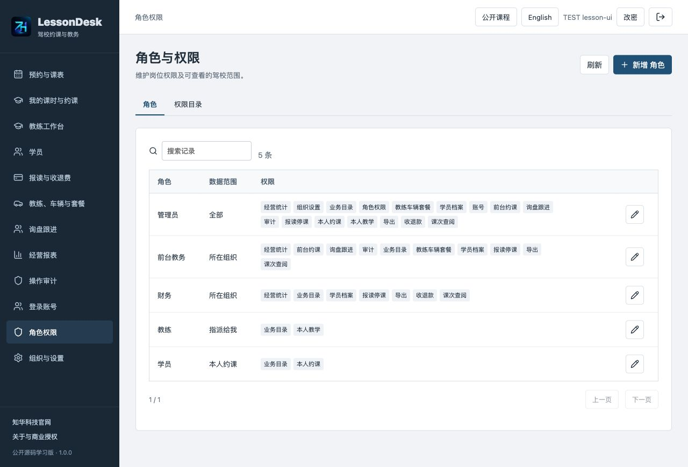

### Public packages: display and private inquiries
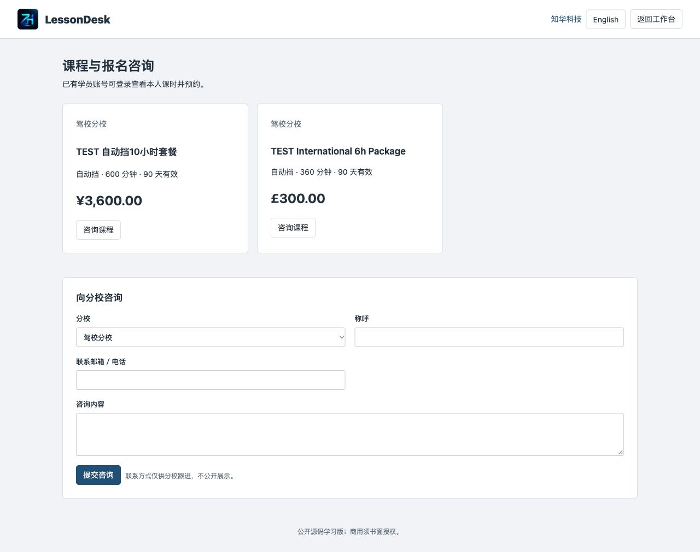

### Mobile: own enrollment and bookings
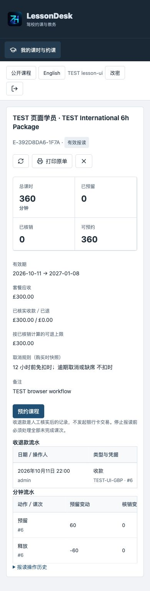

### English: the same business records
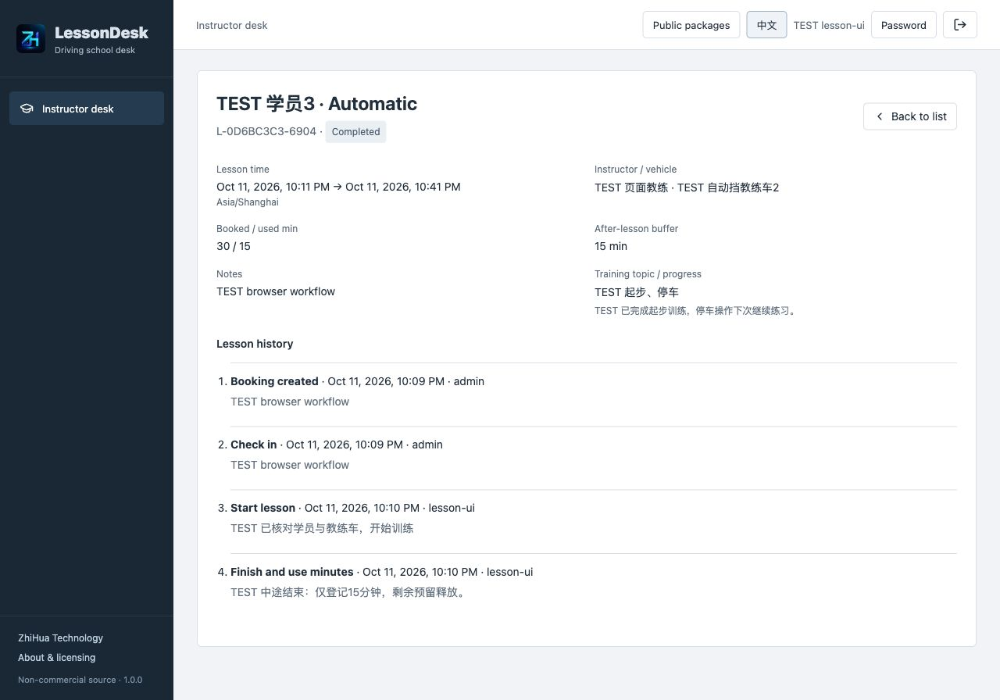

## Tests, deployment and troubleshooting

```bash
mvn -B -f backend/pom.xml spotless:check verify
npm --prefix frontend ci --no-audit --no-fund
npm --prefix frontend run format:check
npm --prefix frontend run lint
npm --prefix frontend test
npm --prefix frontend run build
python3 scripts/release-check.py
```

28 backend tests (6 policy, 22 API integration), 12 frontend tests. Docker Maven builds run tests. Real MySQL verification creates TEST data and **must only run on an isolated localhost empty business database**:

```bash
python3 scripts/quality.py --base http://127.0.0.1:8146
docker compose -p lessondesk restart backend
docker compose -p lessondesk up -d --wait --wait-timeout 180
python3 scripts/verify-persistence.py
```

Actual HTTP counts/results are in ignored `output/mysql-quality.json`; snapshots and temporary passwords stay private. Synthetic data and internal checks do not establish external adoption or payment. See [test scope](docs/TESTING.md).

```bash
python3 scripts/backup.py --project lessondesk --output /private/path/lessondesk-backup.zip
python3 scripts/restore.py /private/path/lessondesk-backup.zip --project lessondesk-restore --env-file /private/path/restore.env
```

Use a private restore.env with another unused local port. Restore validates archives/hashes and rejects existing containers, networks, volumes or occupied ports. Backup briefly stops writes and restarts the backend, contains password hashes and must remain private. Use `down -v` only for dedicated disposable QA volumes.

If an account has no student/instructor records, link its profile first. If no slots are available, verify work, blocks, category, validity, full payment and lead time. Refresh before resolving version conflicts; read the original record after unknown network results instead of blindly resubmitting. Restart invalidates in-memory sessions. Read this project's logs and fix failed checks, never skip tests. Operational deployment needs a domain, TLS, secure cookies, private database networking, edge limits, monitoring and backups; see [deployment](docs/DEPLOYMENT.md) and [security](docs/SECURITY.md).

## Known limitations and third-party setup

No government license/hour certification, official test booking/question bank, certificates, GPS timing, vehicle hardware or dynamic map/travel-time integration. No group theory classes, multiple pupils per vehicle, recurring auto-scheduling, waitlists, instructor payroll, native app, offline mode, multi-company SaaS, self-sign-up or recovery email.

No SMS, automatic outbound email, real payment deduction, legally certified e-signatures or tax invoices. Fee records are manually verified; core workflows require no external service credentials. Work windows are explicit; instructors have up to eight categories. Fixed buffers cannot replace actual travel planning. Terminal lesson minutes cannot be rewritten; specialized correction approval is outside this edition.

Directory reads cap at10,000 and audit returns the newest1,000. No operational load, external penetration or all-browser certification; cross-country rule compliance is not claimed. The default proxy aggregates application inquiry-rate sources, so deployed edge rate limits require topology-specific validation. External CA, domain TLS and paid integrations require separate configuration and acceptance.

## Licensing, feedback and contact

Own code follows [LICENSE](LICENSE) for personal learning, technical research and non-commercial exchange. Commercial use, enterprise deployment, paid delivery/resale and deep customization require prior written authorization. Dependencies keep their own notices; see [third-party information](docs/THIRD_PARTY.md). Provided as-is; deployment teams must assess their actual operating rules and applicable requirements.

Submit sanitized reproductions/improvements through repository Issues/PRs. Never post passwords, cookies or personal records. Report security concerns privately through official contacts.

[ZhiHua Technology website](https://www.zhuatech.cn/) · Source licensing, business-rule customization, deployment and system integration:

- Email: [han@zhuatech.cn](mailto:han@zhuatech.cn)
- Email: [jack@zhuatech.cn](mailto:jack@zhuatech.cn)
- WhatsApp: [+86 17521234993](https://wa.me/8617521234993)
